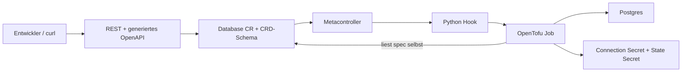

# Panko: OpenTofu als Controller

Lokales Infrastruktur-Labor: Kubernetes ist API und Trigger, OpenTofu provisioniert Postgres.



Setup (Docker muss laufen; Werkzeuge über mise):

```sh
mise install && make cluster-up
make bootstrap && make build && make deploy
make test
```

Alle Befehle verwenden `.local/kubeconfig`; bestehende Kubernetes-Kontexte bleiben unberührt.
`make cluster-down` entfernt ausschließlich den k3d-Cluster `infra-lab` einschließlich seiner Daten.

## Entscheidungen und geprüfte Quellen

- k3d mit einem Server und einem Agent; Versionen in `mise.toml`.
- [k3d Installationsdokumentation](https://k3d.io/stable/).
- [Metacontroller Installation](https://metacontroller.github.io/metacontroller/guide/install.html)
  und [OCI Helm-Chart](https://metacontroller.github.io/metacontroller/guide/helm-install.html).
- [OpenTofu Kubernetes-Backend](https://opentofu.org/docs/language/settings/backends/kubernetes/):
  ein Secret pro Instanz; Leases sperren parallele State-Zugriffe.

## Prüfstand

Die Phasen werden einzeln implementiert, im lokalen Cluster geprüft und committed.

Phase 0 geprüft: `make cluster-up` zeigt zwei Ready-Nodes (k3s v1.35.5+k3s1).
Docker läuft hier über Colima; Docker selbst ist bereits installiert.

Postgres läuft als einzelnes StatefulSet mit PVC und offiziellem `postgres:17.11-alpine`
([offizielle Image-Tags](https://github.com/docker-library/official-images/blob/master/library/postgres)).
Für dieses Labor ist ein StatefulSet einfacher als ein Chart oder zusätzlicher Operator.
Das Admin-Secret wird zufällig und nur beim ersten Bootstrap erzeugt. Anwendungsdienste
bekommen keinen Zugriff darauf; die Runner erhalten später gezielt `get` auf dieses Secret.
Der kurzlebige Bootstrap-Debug-Pod prüft als Administrator die TCP-/Passwortanmeldung.
Cluster-Administratoren und Kubelets bleiben naturgemäß privilegiert.

Phase 1 geprüft: Metacontroller v4.17.6 läuft; Debug-Pod meldet eine erfolgreiche
Passwortverbindung zu PostgreSQL 17.11 über den Cluster-Service.

Phase 2 geprüft: CRD etabliert; Beispiel akzeptiert; `connectionLimit: 0` und eine
Owner-Änderung werden vom API-Server abgelehnt. Alle fachlichen und Statusfelder
haben Beschreibungen. Kubernetes definiert `metadata` implizit und verbietet dort
eine eigene CRD-Beschreibung; das Gateway blendet diese Kubernetes-Hülle aus.
`owner` ist eine unveränderliche fachliche Teamkennung, der Namespace bestimmt die
Zugriffsgrenze. Datenbank- und Rollennamen erhalten zusätzlich einen Hash der CR-UID,
um Kollisionen zwischen Namespaces und nach Neuanlage zu vermeiden.

## Terraform-Modul

`terraform/database/` hat genau zwei Eingaben: `namespace` und `name`. Es liest die
CR über `data "kubernetes_resource"`; `spec` steuert Rolle, Datenbank, Extensions
und Limits. Ein zusätzlicher `hashicorp/random`-Provider erzeugt ein dauerhaftes
Login-Passwort im State. Die Provider-Versionen wurden im OpenTofu-Registry geprüft
und sind mit Lockfile festgelegt. Das Connection-Secret gehört per ownerReference
zur CR. Der Runner stellt nur technische Admin-Credentials per `PGPASSWORD` bereit.
Outputs enthalten ausschließlich Referenzen und den Datenbanknamen.

Phase 3 geprüft: `tofu init -backend=false`, `tofu validate` und `tofu fmt -check`
sind erfolgreich. Kubernetes-Authentifizierung kommt aus technischen `KUBE_*`-
Umgebungsvariablen; dadurch ist validate auch außerhalb eines Pods ausführbar.

## Runner und Berechtigungen

Der Runner verwendet das [offizielle Minimal-Binary-Image](https://opentofu.org/docs/intro/install/docker/)
und einen beim Build erzeugten Provider-Mirror ohne Netzwerk-Fallback. `make build`
baut für die lokale Docker-Architektur (ARM64 oder AMD64) und importiert nach k3d.
Jobs laufen im Namespace ihrer CR; ihre ServiceAccounts dürfen dort Database-CRs
lesen und Secrets verwalten. Zusätzlich dürfen sie State-Secrets und Lock-Leases
in `infra-runners` verwalten sowie ausschließlich `postgres-admin` in `infra-backends`
lesen. Der Kubernetes-Provider braucht außerdem lesenden Cluster-Zugriff auf die
CRD-Schemas. Der Hook bekommt keinen API-Token.

Nach erfolgreichem Destroy entfernt der Runner das leere Backend-State-Secret und
seine Lease. Er meldet erst danach Job-Erfolg. Die beiden Eingaben bleiben reine
CR-Identität; Admin-Credentials sind technische Provider-Authentifizierung.

Phase 4 geprüft: realer Job mit `apply`, Connection-Secret samt ownerReference und
JSON-Outputs; anschließender `destroy`-Job erfolgreich, State-Secret entfernt.
Die CRD deklariert `metadata: {type: object}` ohne eigene Beschreibung, damit der
Provider die impliziten Kubernetes-Metadaten einschließlich UID erkennt.
