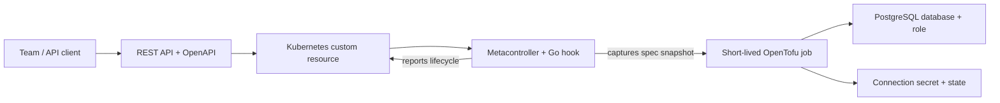

<p align="center">
  <picture>
    <source media="(prefers-color-scheme: dark)" srcset="docs/brand/panko-horizontal-dark.svg">
    <source media="(prefers-color-scheme: light)" srcset="docs/brand/panko-horizontal-light.svg">
    
  </picture>
</p>

<h1 align="center">A thin wrapper for Terraform.</h1>

<p align="center">
  Turn infrastructure code into a self-service API.<br>
  Built with OpenTofu, Kubernetes, and a love for open source.
</p>

<p align="center">
  <a href="#why-panko">Why Panko</a> ·
  <a href="#how-it-works">How it works</a> ·
  <a href="#quick-start">Quick start</a> ·
  <a href="docs/local-lab.de.md">Technical guide (Deutsch)</a> ·
  <a href="docs/brand/README.md">Logo kit</a>
</p>

## Why Panko?

We love open source. We love writing Terraform: small modules, readable changes, and infrastructure expressed as code that we can review, share, and improve together.

As more teams need infrastructure, the work grows around that code. Who can request a database? Which inputs are valid? Where does state live? What happens when a request changes or a resource is deleted? We want to address those questions at a larger scale while keeping the tools understandable and the platform light.

That is where **Panko** comes in: a thin wrapper between the people requesting infrastructure and the code that provisions it. Platform engineers write the modules and define the resource contract. Teams request resources through an API. Panko connects those requests to short-lived OpenTofu jobs, using Kubernetes for validation, lifecycle, and status.

The ambition is simple: keep the joy of Terraform coding as infrastructure becomes a shared service. Build on open-source tools, keep the moving parts small, and make the path from a request to a resource easy to follow.

**Current status:** Panko is a working local prototype. It provisions PostgreSQL databases with OpenTofu in a k3d cluster and exposes a team-scoped REST API. Supporting larger deployments is the design goal; production readiness and large-scale performance have not been established. The runner currently uses OpenTofu; Terraform CLI execution is not tested or configured.

## How it works



- **One resource contract.** CRDs define fields, defaults, and validation. The gateway derives OpenAPI from exposed CRDs, including resources added at runtime.
- **A small provisioning boundary.** The [example module](https://github.com/hingst-it/panko-database) lives in its own repository and receives the resource identity and an immutable spec snapshot captured by the controller. The gateway does not maintain a second mapping of business fields to Terraform variables.
- **Jobs for execution.** The controller starts OpenTofu jobs for changed generations or module revisions, serializes changes per resource, and reports their outcome. Each job copies the engine from the official OpenTofu image and fetches the module at a pinned commit with git-sync.
- **An explicit lifecycle.** A finalizer keeps a resource in `Deleting` until its destroy job and state cleanup succeed. Credentials are delivered through a connection Secret.
- **Team-scoped access.** Local bearer tokens map requests to team namespaces, backed by explicit Kubernetes RBAC.
- **Team-selected state.** Teams choose an operator-approved state destination (S3) through a `StateBackend`; the built-in Kubernetes backend stays the default. Each resource binds once, and the runner refuses to run when the backend or established state does not match. See [state backends](docs/state-backends.de.md).

“Thin” describes Panko's own layer. It still relies on Kubernetes, Metacontroller, and OpenTofu. This approach is aimed at teams that want to use those building blocks to expose infrastructure code as a service.

## Quick start

You need a running Docker engine and [mise](https://mise.jdx.dev/). Tool versions are pinned in [mise.toml](mise.toml). Runner jobs fetch the module from the private repository `hingst-it/panko-database`; place its read-only deploy key at `.local/module-deploy-key` (mode 0600) or point `MODULE_SSH_KEY_FILE` to it. Run these commands from the repository root:

```sh
mise trust
mise install
mise exec -- python3 -m venv .venv
.venv/bin/python -m pip install -r requirements-dev.txt
make cluster-up
make bootstrap
make build
make deploy
make test
```

This creates the `infra-lab` k3d cluster, bootstraps PostgreSQL and Metacontroller, builds the runner and gateway images, deploys Panko, and runs the database lifecycle tests. Commands use `.local/kubeconfig` and leave your existing Kubernetes contexts unchanged. Initial setup and image builds require internet access.

### Request a database

Start the local gateway in a separate terminal:

```sh
make gateway-forward
```

Then load the local `team-a` token and create a database:

```sh
TOKEN="$(mise exec -- python -c 'import json; print(json.load(open(".local/team-tokens.json"))["team-a"])')"

curl -sS http://127.0.0.1:8081/v1/teams/team-a/databases \
  -H "Authorization: Bearer $TOKEN" \
  -H 'Content-Type: application/json' \
  -d '{"name":"orders","spec":{"owner":"team-a","extensions":["pgcrypto"],"connectionLimit":20}}'
```

Check the resource until its status reports `Ready`:

```sh
curl -sS http://127.0.0.1:8081/v1/teams/team-a/databases/orders \
  -H "Authorization: Bearer $TOKEN"
```

The runner creates an `orders-connection` Secret in `team-a` with the connection details. Credentials stay out of the HTTP resource response.

Delete the database through the same API:

```sh
curl -sS -X DELETE http://127.0.0.1:8081/v1/teams/team-a/databases/orders \
  -H "Authorization: Bearer $TOKEN"
```

Deletion is asynchronous: the finalizer waits for OpenTofu to destroy the database and role and clean up state before the custom resource disappears.

Explore the API at [Swagger UI](http://127.0.0.1:8081/docs) or retrieve the [OpenAPI document](http://127.0.0.1:8081/openapi.json). Use your team token to authorize requests. Set `GATEWAY_PORT` to change the local port, for example `make gateway-forward GATEWAY_PORT=9090`.

### Validate and clean up

| Command | Purpose |
| --- | --- |
| `make test-unit lint-go` | Run Go unit/contract tests with the race detector, formatting checks and go vet. |
| `make lint` | Lint the Python E2E tests and tools after installing `requirements-dev.txt`. |
| `make test` | Exercise provisioning, updates, schema validation, deletion, and parallel resources across two team namespaces. |
| `make test-gateway` | Check HTTP lifecycle, team isolation, dynamic CRD discovery, OpenAPI validation, and generated Python client code. |
| `make gateway-rbac` | Rebuild explicit gateway permissions after changing exposed resource types. |
| `make clean` | Delete all Database resources in `team-a` and `team-b` through their regular finalizers. |
| `make cluster-down` | Remove the entire `infra-lab` cluster, including its data. |

## Inside the repository

| Path | Responsibility |
| --- | --- |
| [api/](api/) | Database, StateBackend and BackendProfile CRDs, validation, and an example resource. |
| [cmd/](cmd/) / [internal/](internal/) | Go gateway, reconciliation hook, runner, administrator commands and shared packages. |
| [controller/](controller/) | Metacontroller configuration and hook deployment, including the pinned engine image and module revision. |
| [runner/](runner/) | Image build script for runner, hook and gateway. |
| [gateway/](gateway/) | Gateway deployment; implementation and CRD-derived OpenAPI live under `internal/gateway`. |
| [cluster/](cluster/) | Local cluster setup, PostgreSQL, and deployment scripts. |
| [test/](test/) | Controller checks and cluster-backed lifecycle/API tests. |
| [docs/local-lab.de.md](docs/local-lab.de.md) | Original German technical guide and implementation/verification notes. |
| [docs/state-backends.de.md](docs/state-backends.de.md) | Team-defined state backends, safety checks, lab S3 and migration. |
| [docs/brand/](docs/brand/) | Logos, wordmarks, monochrome variants, icons, and social artwork. |

## Scope and limitations

Gateway, Metacontroller hook, runner and administrator commands are implemented in Go. Python remains for external E2E tests and optional tooling. The [Go migration guide](docs/go-porting.de.md) records the component transitions and rollback procedure.

The local example demonstrates the full request-to-resource lifecycle. It currently uses one PostgreSQL instance with a PVC, two configured team namespaces, local development images, and static team tokens. High availability, backups, PostgreSQL TLS, OIDC authentication, and production-grade tenant isolation are outside the implemented scope.

Applies run on spec/generation changes. There is no periodic drift reconciliation or automatic retry of a failed apply for the same generation. Failed destroys retain the finalizer and persist their outcome after Job TTL expiry. An administrator explicitly changes the `platform.example.com/retry-destroy` annotation to request another attempt.

OpenTofu state lives in team-specific Kubernetes namespaces and includes credentials. Runner RBAC separates team states and blocks access to gateway tokens, while both runners still share privileged PostgreSQL credentials. The gateway enforces the HTTP team boundary using a shared service account. See the [operations guide](docs/operations.de.md) for upgrades from the shared backend, explicit retries, execution snapshots, discovery caching, JSON logs and Prometheus metrics. GitHub Actions runs unit checks and a separate cluster-backed E2E job. The [technical guide](docs/local-lab.de.md#bekannte-grenzen) covers other local-lab limitations.

## Build with us

Panko grows out of an appreciation for open source and the people who make infrastructure tools better together. Ideas, bug reports, documentation improvements, and focused patches are welcome. Help us make the wrapper useful while keeping its responsibilities clear and its implementation small.

For a change, explain the infrastructure workflow it improves and how you checked it. The lifecycle and gateway tests above are useful starting points when changing runtime behavior.

The repository does not yet include a license file; an explicit open-source license still needs to be selected and added by the maintainers.
