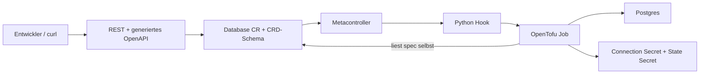

# Panko: OpenTofu als Controller

Lokales Infrastruktur-Labor: Kubernetes ist API und Trigger, OpenTofu provisioniert Postgres.



Setup (Docker muss laufen; Werkzeuge über mise):

```sh
mise install && make cluster-up
make bootstrap && make build && make deploy
make test
```

Alle Befehle verwenden `.local/kubeconfig`; bestehende Kubernetes-Kontexte bleiben unberührt.
`make cluster-down` entfernt ausschließlich den k3d-Cluster `infra-lab` einschließlich seiner Daten.

## Entscheidungen und geprüfte Quellen

- k3d mit einem Server und einem Agent; Versionen in `mise.toml`.
- [k3d Installationsdokumentation](https://k3d.io/stable/).
- [Metacontroller Installation](https://metacontroller.github.io/metacontroller/guide/install.html)
  und [OCI Helm-Chart](https://metacontroller.github.io/metacontroller/guide/helm-install.html).
- [OpenTofu Kubernetes-Backend](https://opentofu.org/docs/language/settings/backends/kubernetes/):
  ein Secret pro Instanz; Leases sperren parallele State-Zugriffe.

## Prüfstand

Die Phasen werden einzeln implementiert, im lokalen Cluster geprüft und committed.

Phase 0 geprüft: `make cluster-up` zeigt zwei Ready-Nodes (k3s v1.35.5+k3s1).
Docker läuft hier über Colima; Docker selbst ist bereits installiert.

Postgres läuft als einzelnes StatefulSet mit PVC und offiziellem `postgres:17.11-alpine`
([offizielle Image-Tags](https://github.com/docker-library/official-images/blob/master/library/postgres)).
Für dieses Labor ist ein StatefulSet einfacher als ein Chart oder zusätzlicher Operator.
Das Admin-Secret wird zufällig und nur beim ersten Bootstrap erzeugt. Anwendungsdienste
bekommen keinen Zugriff darauf; die Runner erhalten später gezielt `get` auf dieses Secret.
Der kurzlebige Bootstrap-Debug-Pod prüft als Administrator die TCP-/Passwortanmeldung.
Cluster-Administratoren und Kubelets bleiben naturgemäß privilegiert.

Phase 1 geprüft: Metacontroller v4.17.6 läuft; Debug-Pod meldet eine erfolgreiche
Passwortverbindung zu PostgreSQL 17.11 über den Cluster-Service.
