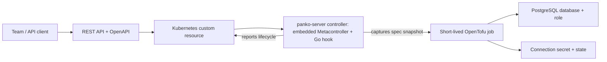

<p align="center">
  <picture>
    <source media="(prefers-color-scheme: dark)" srcset="docs/brand/panko-horizontal-dark.svg">
    <source media="(prefers-color-scheme: light)" srcset="docs/brand/panko-horizontal-light.svg">
    
  </picture>
</p>

<h1 align="center">A thin wrapper for Terraform.</h1>

<p align="center">
  Turn infrastructure code into a self-service API.<br>
  Built with OpenTofu, Kubernetes, and a love for open source.
</p>

<p align="center">
  <a href="#why-panko">Why Panko</a> ·
  <a href="#how-it-works">How it works</a> ·
  <a href="#quick-start">Quick start</a> ·
  <a href="docs/local-lab.de.md">Technical guide (Deutsch)</a> ·
  <a href="docs/brand/README.md">Logo kit</a>
</p>

## Why Panko?

We love open source. We love writing Terraform: small modules, readable changes, and infrastructure expressed as code that we can review, share, and improve together.

As more teams need infrastructure, the work grows around that code. Who can request a database? Which inputs are valid? Where does state live? What happens when a request changes or a resource is deleted? We want to address those questions at a larger scale while keeping the tools understandable and the platform light.

That is where **Panko** comes in: a thin wrapper between the people requesting infrastructure and the code that provisions it. Platform engineers write the modules and define the resource contract. Teams request resources through an API. Panko connects those requests to short-lived OpenTofu jobs, using Kubernetes for validation, lifecycle, and status.

The ambition is simple: keep the joy of Terraform coding as infrastructure becomes a shared service. Build on open-source tools, keep the moving parts small, and make the path from a request to a resource easy to follow.

**This branch** (`poc/unified-server-dev-install`) is a proof of concept: one `panko-server` binary for all runtime roles with Metacontroller embedded in the controller role, a Helm chart used by `panko install`, `panko dev up` and GitOps, and a local lab without checkout or background processes. See the [evaluation (Deutsch)](docs/poc-unified-server.de.md), [installation](docs/installation.md) and [GitOps](docs/gitops.md). It is not released.

**Current release:** v0.0.1 is the first public experimental release for local evaluation and personal installations. It provisions PostgreSQL databases with OpenTofu in a k3d cluster and exposes a team-scoped REST API. APIs and configuration may change. Production readiness and large-scale performance have not been established; Terraform CLI execution is not tested or configured. See the [changelog](CHANGELOG.md) and [release notes](docs/release-notes/v0.0.1.md).

## How it works



- **One resource contract.** CRDs define fields, defaults, and validation. The gateway derives OpenAPI from exposed CRDs, including resources added at runtime.
- **A small provisioning boundary.** The [example module](https://github.com/hingst-it/panko-database) lives in its own repository and receives the resource identity and an immutable spec snapshot captured by the controller. The gateway does not maintain a second mapping of business fields to Terraform variables.
- **Jobs for execution.** The controller starts OpenTofu jobs for changed generations or module revisions, serializes changes per resource, and reports their outcome. Each job copies the engine from the official OpenTofu image and fetches the module at a pinned commit with git-sync.
- **An explicit lifecycle.** A finalizer keeps a resource in `Deleting` until its destroy job and state cleanup succeed. Credentials are delivered through a connection Secret.
- **A small inspector.** Open the gateway’s `/ui` with a team token to inspect status, retry executions, check drift, and view a sanitized resource graph from the last successful apply. Tokens stay in page memory. See [operations](docs/operations.de.md#inspektor-und-ressourcengraph).
- **Team-scoped access.** Local bearer tokens map requests to team namespaces, backed by explicit Kubernetes RBAC.
- **Remote runners.** A team can be assigned to a runner pool whose agents run outside the cluster, as a container, a systemd service or in another cluster, and reach only outbound to Panko's runner endpoint. Teams without a pool keep in-cluster Jobs. See [remote runners](docs/remote-runners.de.md).
- **Team-selected state.** Teams choose an operator-approved state destination (S3) through a `StateBackend`; the built-in Kubernetes backend stays the default. Each resource binds once, and the runner refuses to run when the backend or established state does not match. See [state backends](docs/state-backends.de.md).

- **Two programs, one chart.** `panko` manages resources, administers (`panko admin`), installs (`panko install`) and runs a local lab (`panko dev`); `panko-server` runs the roles `gateway`, `controller`, `endpoint`, `mirror`, `runner`, `agent` and `setup`, each in its own pod or Job with its own ServiceAccount. The Helm chart in [charts/panko](charts/panko) is the only installation path.

“Thin” describes Panko's own layer. It still relies on Kubernetes, Metacontroller (embedded as a pinned Go dependency), and OpenTofu. This approach is aimed at teams that want to use those building blocks to expose infrastructure code as a service.

## Quick start

Follow the [quickstart](docs/quickstart.md) for this proof of concept. For help from an AI
assistant, use the [agent installation guide](docs/agent-install.md).

The released 0.0.1 CLI (Homebrew, mise, asdf) has no `install` or `dev` command; build
`panko` and the two images from this branch once (no registry is used):

```sh
go build -o panko ./cmd/panko
docker build -t panko-server:dev -f Dockerfile.server .
docker build -t panko-module-mirror:dev -f cluster/Dockerfile.module-mirror .
```

Then, from any directory and without a checkout:

```sh
./panko dev up --server-image panko-server:dev --module-mirror-image panko-module-mirror:dev
```

This needs a running Docker engine on macOS or Linux; a missing k3d is installed privately after
you agree, with its checksum verified. It creates the dedicated cluster `k3d-panko-dev`, installs
the chart with PostgreSQL and a local S3 service, and maps the API to `http://127.0.0.1:8081`.
`~/.kube/config` stays unchanged. `panko dev status` shows the lab; `panko dev down` removes it.
For an existing cluster use `panko install --kubeconfig ./config --context mein-cluster`; for
GitOps see [docs/gitops.md](docs/gitops.md).

Contributors can use the pinned tools in [mise.toml](mise.toml) and the same chart from a
checkout: `make cluster-up build deploy` builds the images, imports them into k3d and runs
`panko install` with [cluster/lab-values.yaml](cluster/lab-values.yaml) and
[panko.json](panko.json). That lab has no port mapping; run `make gateway-forward` for
`http://127.0.0.1:8081`. The optional full test suite additionally requires a Python `.venv`
with `requirements-dev.txt` installed.

### Request a database

With `panko dev up`, export the printed `PANKO_URL`, `PANKO_TOKENS_FILE` and `PANKO_KUBECONFIG`
and drop the `.local/bin/` prefix below. From a checkout lab, start `make gateway-forward` in a
separate terminal and run the database lifecycle:

```sh
make build-go
.local/bin/panko --team team-a create orders --extensions pgcrypto --connection-limit 20
.local/bin/panko --team team-a wait orders --timeout 5m
.local/bin/panko --team team-a list
.local/bin/panko --team team-a get orders
.local/bin/panko --team team-a connect orders
# After fixing a failed execution:
.local/bin/panko --team team-a retry orders
.local/bin/panko --team team-a delete orders --wait
```

`connect` prints the connection URI and deliberately reads the connection Secret with
`.local/kubeconfig` (or `PANKO_KUBECONFIG`); keep that output private. The gateway has no Secret access.
For diagnostics, run `.local/bin/panko doctor`. Tokens are read from `PANKO_TOKEN` or the token file
(`PANKO_TOKENS_FILE`, default `.local/team-tokens.json`) without putting them in command arguments. `--team` defaults
to `PANKO_TEAM`, or the only team in `panko.json`. `--url` / `PANKO_URL` defaults to
`http://127.0.0.1:8081`. See the [CLI operations guide](docs/operations.de.md#cli-für-den-alltag)
for spec files, connection formats, exit codes, and token rotation.

For reference, the same HTTP API can be called with curl. Load the local `team-a`
token and create a database:

```sh
TOKEN="$(mise exec -- python -c 'import json; print(json.load(open(".local/team-tokens.json"))["team-a"])')"

curl -sS http://127.0.0.1:8081/v1/teams/team-a/databases \
  -H "Authorization: Bearer $TOKEN" \
  -H 'Content-Type: application/json' \
  -d '{"name":"orders","spec":{"owner":"team-a","extensions":["pgcrypto"],"connectionLimit":20}}'
```

Check the resource until its status reports `Ready`:

```sh
curl -sS http://127.0.0.1:8081/v1/teams/team-a/databases/orders \
  -H "Authorization: Bearer $TOKEN"
```

The runner creates an `orders-connection` Secret in `team-a` with the connection details. Credentials stay out of the HTTP resource response.

Delete the database through the same API:

```sh
curl -sS -X DELETE http://127.0.0.1:8081/v1/teams/team-a/databases/orders \
  -H "Authorization: Bearer $TOKEN"
```

Deletion is asynchronous: the finalizer waits for OpenTofu to destroy the database and role and clean up state before the custom resource disappears.

Explore the API at [Swagger UI](http://127.0.0.1:8081/docs) or retrieve the [OpenAPI document](http://127.0.0.1:8081/openapi.json). Use your team token to authorize requests. Set `GATEWAY_PORT` to change the local port, for example `make gateway-forward GATEWAY_PORT=9090`.

### Validate and clean up

| Command | Purpose |
| --- | --- |
| `make test-unit lint-go` | Run Go unit/contract tests with the race detector, Helm lint and reproducible rendering, formatting checks and go vet. |
| `make lint` | Lint the Python E2E tests and tools after installing `requirements-dev.txt`. |
| `make test` | Exercise provisioning, updates, schema validation, deletion, and parallel resources across two team namespaces. |
| `make test-gateway` | Check HTTP lifecycle, team isolation, dynamic CRD discovery, OpenAPI validation, and generated Python client code. |
| `make gateway-rbac` | Rebuild explicit gateway permissions after changing exposed resource types. |
| `make clean` | Delete all Database resources in `team-a` and `team-b` through their regular finalizers. |
| `make cluster-down` | Remove the entire `infra-lab` cluster, including its data. |

## Inside the repository

| Path | Responsibility |
| --- | --- |
| [charts/panko/](charts/panko/) | The Helm chart: CRDs (Panko and Metacontroller), RBAC, roles, setup Job, optional lab PostgreSQL and S3. |
| [cmd/](cmd/) / [internal/](internal/) | `panko` and `panko-server` (roles under `internal/roles`), the legacy `admin` wrapper, chart, install and lab code, and shared packages. |
| [api/](api/) | An example Database resource. |
| [examples/gitops/](examples/gitops/) | Values for an existing cluster, Argo CD and Flux examples, pre-rendered manifests. |
| [runner/](runner/) | Image build script for `panko-server` and the module mirror. |
| [cluster/](cluster/) | Local k3d cluster, lab values, `make deploy` wrapper around `panko install`, backup and restore scripts. |
| [test/](test/) | Controller checks and cluster-backed lifecycle/API tests. |
| [docs/local-lab.de.md](docs/local-lab.de.md) | Original German technical guide and implementation/verification notes. |
| [docs/state-backends.de.md](docs/state-backends.de.md) | Team-defined state backends, safety checks, lab S3 and migration. |
| [docs/remote-runners.de.md](docs/remote-runners.de.md) | Remote runner pools, agents, tokens, recovery and limits. |
| [docs/releases.md](docs/releases.md) | Tag releases, required CI checks, binary archives and GHCR images. |
| [docs/self-hosted-ci.md](docs/self-hosted-ci.md) | Flux-managed hosting workers, isolation, job routing and recovery. |
| [docs/quickstart.md](docs/quickstart.md) / [docs/agent-install.md](docs/agent-install.md) | Installation and instructions for AI-assisted setup. |
| [docs/installation.md](docs/installation.md) / [docs/gitops.md](docs/gitops.md) | `panko install`, `panko dev`, Helm and CLI responsibilities; `helm template`, Argo CD and Flux. |
| [docs/poc-unified-server.de.md](docs/poc-unified-server.de.md) | Evaluation of this proof of concept (Deutsch). |
| [docs/brand/](docs/brand/) | Logos, wordmarks, monochrome variants, icons, and social artwork. |

## Scope and limitations

Gateway, controller (embedded Metacontroller and hook), runner and administrator commands are implemented in Go. Python remains for external E2E tests and optional tooling. The [Go migration guide](docs/go-porting.de.md) records the component transitions and rollback procedure.

The local example demonstrates the full request-to-resource lifecycle for a personal installation. It uses one PostgreSQL instance with a PVC, teams declared in `panko.json`, local development images, and static team tokens. A rehearsed backup and restore (`make backup`, `make restore`) covers Panko's resources and the example PostgreSQL. High availability, PostgreSQL TLS, OIDC authentication, and production-grade tenant isolation are outside the implemented scope; Database is the only resource type.

Applies run on spec/generation changes and module revision changes (or, with manual rollouts, on `admin upgrade-module`). Failed applies are not retried automatically: failures carry a code in `status.lastExecution`, and `panko retry NAME` requests another attempt. Drift checks run a read-only plan on request (`panko plan NAME`) or on an optional schedule and never repair. Failed destroys retain the finalizer and persist their outcome after Job TTL expiry. Optional egress rules restrict runner pods to Panko components and declared targets.

OpenTofu state lives in team-specific Kubernetes namespaces and includes credentials. Runner RBAC separates team states and blocks access to gateway tokens, while both runners still share privileged PostgreSQL credentials. The gateway enforces the HTTP team boundary using a shared service account. See the [operations guide](docs/operations.de.md) for upgrades from the shared backend, explicit retries, execution snapshots, discovery caching, JSON logs and Prometheus metrics. GitHub Actions runs unit checks and a separate cluster-backed E2E job. The [technical guide](docs/local-lab.de.md#bekannte-grenzen) covers other local-lab limitations.

## Build with us

Panko grows out of an appreciation for open source and the people who make infrastructure tools better together. Ideas, bug reports, documentation improvements, and focused patches are welcome. Help us make the wrapper useful while keeping its responsibilities clear and its implementation small.

For a change, explain the infrastructure workflow it improves and how you checked it. The lifecycle and gateway tests above are useful starting points when changing runtime behavior.

The roadmap lives on the [Panko Roadmap project](https://github.com/orgs/hingst-it/projects/1), with [milestones](https://github.com/hingst-it/panko/milestones) and the finished items with their evidence.

## License

Panko is licensed under the [Apache License 2.0](LICENSE) (SPDX identifier: `Apache-2.0`).
