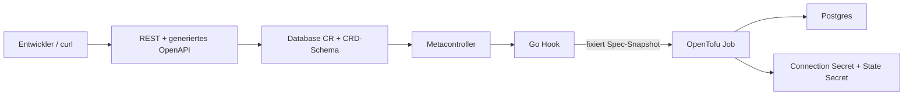

# Panko: OpenTofu als Controller

> Technischer Leitfaden und bisheriges Prüfprotokoll. Zur [Projektübersicht](../README.md).
> Alle Befehle und Codepfade beziehen sich auf das Repository-Hauptverzeichnis.
> Aktuelle Betriebs-, Migrations- und Testanleitung: [operations.de.md](operations.de.md).
> Die Runtime ist inzwischen nach Go portiert; Aufbau und Rückwechsel: [go-porting.de.md](go-porting.de.md).
> Die folgenden Prüfvermerke dokumentieren frühere Implementierungsläufe; sie sind kein aktueller CI-Status.

Lokales Infrastruktur-Labor: Kubernetes ist API und Trigger, OpenTofu provisioniert Postgres.



Setup (Docker muss laufen; Werkzeuge über mise):

```sh
mise trust && mise install
mise exec -- python3 -m venv .venv
.venv/bin/python -m pip install -r requirements-dev.txt
make cluster-up
make bootstrap && make build && make deploy
make test
```

Alle Befehle verwenden `.local/kubeconfig`; bestehende Kubernetes-Kontexte bleiben unberührt.
`make cluster-down` entfernt ausschließlich den k3d-Cluster `infra-lab` einschließlich seiner Daten.

## Entscheidungen und geprüfte Quellen

- k3d mit einem Server und einem Agent; Versionen in `mise.toml`.
- [k3d Installationsdokumentation](https://k3d.io/stable/).
- [Metacontroller Installation](https://metacontroller.github.io/metacontroller/guide/install.html)
  und [OCI Helm-Chart](https://metacontroller.github.io/metacontroller/guide/helm-install.html).
- [OpenTofu Kubernetes-Backend](https://opentofu.org/docs/language/settings/backends/kubernetes/):
  ein Secret pro Instanz; Leases sperren parallele State-Zugriffe.

## Prüfstand

Die Phasen werden einzeln implementiert, im lokalen Cluster geprüft und committed.

Phase 0 geprüft: `make cluster-up` zeigt zwei Ready-Nodes (k3s v1.35.5+k3s1).
Docker läuft hier über Colima; Docker selbst ist bereits installiert.

Postgres läuft als einzelnes StatefulSet mit PVC und offiziellem `postgres:17.11-alpine`
([offizielle Image-Tags](https://github.com/docker-library/official-images/blob/master/library/postgres)).
Für dieses Labor ist ein StatefulSet einfacher als ein Chart oder zusätzlicher Operator.
Das Admin-Secret wird zufällig und nur beim ersten Bootstrap erzeugt. Anwendungsdienste
bekommen keinen Zugriff darauf; die Runner erhalten später gezielt `get` auf dieses Secret.
Der kurzlebige Bootstrap-Debug-Pod prüft als Administrator die TCP-/Passwortanmeldung.
Cluster-Administratoren und Kubelets bleiben naturgemäß privilegiert.

Phase 1 geprüft: Metacontroller v4.17.6 läuft; Debug-Pod meldet eine erfolgreiche
Passwortverbindung zu PostgreSQL 17.11 über den Cluster-Service.

Phase 2 geprüft: CRD etabliert; Beispiel akzeptiert; `connectionLimit: 0` und eine
Owner-Änderung werden vom API-Server abgelehnt. Alle fachlichen und Statusfelder
haben Beschreibungen. Kubernetes definiert `metadata` implizit und verbietet dort
eine eigene CRD-Beschreibung; das Gateway blendet diese Kubernetes-Hülle aus.
`owner` ist eine unveränderliche fachliche Teamkennung, der Namespace bestimmt die
Zugriffsgrenze. Datenbank- und Rollennamen erhalten zusätzlich einen Hash der CR-UID,
um Kollisionen zwischen Namespaces und nach Neuanlage zu vermeiden.

## Terraform-Modul

`terraform/database/` erhält `namespace`, `name` und einen unveränderlichen
Ressourcen-Snapshot `resource`. Dessen Spec steuert Rolle, Datenbank, Extensions und
Limits ohne zusätzliches fachliches Mapping im Runner. Der Random-Provider erzeugt
ein dauerhaftes Login-Passwort im State. Provider sind mit Lockfile festgelegt.
Das Connection-Secret gehört per ownerReference zur CR. Technische Credentials
kommen aus der Runner-Umgebung; Outputs enthalten Referenzen und Datenbanknamen.

Phase 3 geprüft: `tofu init -backend=false`, `tofu validate` und `tofu fmt -check`
sind erfolgreich. Kubernetes-Authentifizierung kommt aus technischen `KUBE_*`-
Umgebungsvariablen; dadurch ist validate auch außerhalb eines Pods ausführbar.

## Runner und Berechtigungen

Der Runner verwendet das [offizielle Minimal-Binary-Image](https://opentofu.org/docs/intro/install/docker/)
und einen beim Build erzeugten Provider-Mirror ohne Netzwerk-Fallback. `make build`
baut für die lokale Docker-Architektur (ARM64 oder AMD64) und importiert nach k3d.
Jobs laufen im Namespace ihrer CR; ihre ServiceAccounts dürfen dort Database-CRs
lesen und Secrets verwalten. Zusätzlich dürfen sie State-Secrets und Lock-Leases
im jeweiligen Namespace `panko-state-team-a` bzw. `panko-state-team-b` verwalten.
In `infra-backends` dürfen sie ausschließlich `postgres-admin` lesen. Der Kubernetes-Provider braucht außerdem lesenden Cluster-Zugriff auf die
CRD-Schemas. Der Hook bekommt keinen API-Token.

Nach erfolgreichem Destroy entfernt der Runner das leere Backend-State-Secret und
seine Lease. Er meldet erst danach Job-Erfolg. Der Ressourcen-Snapshot bleibt
während eines Jobs unverändert; Admin-Credentials sind technische Provider-Authentifizierung. Gateway-Tokens liegen getrennt in `infra-gateway`.

Phase 4 geprüft: realer Job mit `apply`, Connection-Secret samt ownerReference und
JSON-Outputs; anschließender `destroy`-Job erfolgreich, State-Secret entfernt.
Die CRD deklariert `metadata: {type: object}` ohne eigene Beschreibung, damit der
Provider die impliziten Kubernetes-Metadaten einschließlich UID erkennt.

## Reconciliation

Der Hook hasht kanonisches JSON aus `spec` und Generation. Job-Namen enthalten den
gekürzten CR-Namen und einen Hash aus UID, Konfigurationshash, Aktion und Versuch.
Eine laufende ältere Generation wird beendet, bevor eine neue startet. Erfolgreiche aktuelle Jobs bleiben
bis zur TTL von einer Stunde erhalten; der Status verhindert nach Ablauf erneute
Applies derselben Generation. Alte abgeschlossene Jobs entfernt Metacontroller.
Fehlgeschlagene Applies werden mit `Failed` gemeldet; eine Spec-Änderung startet
einen neuen Versuch. Jobs haben ein Zeitlimit von fünf Minuten und keine Pod-Retries.

Beim Löschen wartet der Hook auf laufende Jobs und startet anschließend Destroy.
Die CR bleibt `Deleting` und behält ihren Finalizer bis zum erfolgreichen Destroy
inklusive State-Löschung. Fehlgeschlagene Destroy-Jobs bleiben zur Diagnose stehen;
ein neuer Wert der Annotation `platform.example.com/retry-destroy` fordert explizit
einen weiteren Versuch an. Das Ergebnis bleibt nach Ablauf der Job-TTL im Status erhalten.
Kein periodischer Drift-Apply ist aktiviert.

Phase 5 geprüft: drei Hook-Tests (Generationen serialisieren, TTL, Finalisierung)
und ein realer CR-Lauf bis `Ready`, danach Finalizer-Destroy bis zur verschwundenen
CR und leerem State-Namespace. Runner-Jobs laufen ohne Root und mit schreibgeschütztem
Root-Dateisystem; nur `/work` und `/tmp` sind beschreibbar.

## Tests und Aufräumen

`make test` prüft echte Ressourcen statt Mocks:

1. CR wird Ready, Secret mit ownerReference existiert, psql meldet sich mit den
   Anwendungscredentials an und findet pgcrypto.
2. Eine neue Generation erzeugt einen neuen erfolgreichen Job; Datenbank- und
   Rollenlimit werden in PostgreSQL auf den neuen Wert geprüft.
3. Schema- und CEL-Verstöße werden abgelehnt.
4. Während Destroy bleibt die CR mit Finalizer in Deleting. Nach ihrem Verschwinden
   sind Datenbank, Rolle, Connection-Secret und State-Secret nachweislich weg.
5. Zwei CRs in unterschiedlichen Team-Namespaces werden parallel unabhängig Ready.

Phase 6: alle fünf Szenarien erfolgreich ausgeführt. E2E-Namen enthalten eine
Laufkennung. Bei Fehlern werden normale Löschungen angefordert; Job-Logs bleiben
zur Diagnose bis zur TTL erhalten. `make clean` löscht alle Database-Instanzen in
team-a und team-b über den regulären Finalizer. `make cluster-down` entfernt das Labor.

## Entwickler-API

Der Gateway nutzt Go `net/http` für HTTP und liefert Swagger UI aus. Das OpenAPI-Dokument
erzeugt `internal/gateway/schema.go` direkt aus den aktuellen, mit
`platform.example.com/expose: "true"` markierten CRDs. `spec`, `status`, Defaults,
Enums und Beschreibungen stammen aus deren `openAPIV3Schema`; es gibt keine
fachlichen Pydantic-Modelle oder Terraform-Variablen-Mappings. Das Dokument wird
aus einem kurzzeitig gecachten Discovery-Ergebnis erzeugt (Standard fünf Sekunden).
Neue namespaced CRDs mit `spec` erscheinen ohne Neubau oder Neustart. Alle served-Versionen erhalten eigene Routen. Die API
verwendet die Version und den Pluralnamen aus der CRD; kollidierende Routen
verschiedener Gruppen werden als Konfigurationsfehler gemeldet.

Der kleine Request-Umschlag (`name` + `spec`), HTTP-Fehler und die Team-Route sind
Transportdefinitionen. Das fachliche Schema wird weder kopiert noch von Hand
gepflegt. Kubernetes-`nullable` wird nach JSON Schema 2020-12 übersetzt. PATCH nutzt
JSON Merge Patch; optionale Felder lassen sich mit null entfernen bzw. auf ihre
Defaults zurücksetzen. Validierungen einschließlich CEL wertet ausschließlich der
API-Server aus. Fehler kommen mit HTTP 422 sowie `errors[].field` und
`errors[].message` zurück. Unbekannte Felder werden strikt abgelehnt.

Als Administrator einmal in einem eigenen Terminal starten:

```sh
make gateway-forward
```

Der lokale Port ist standardmäßig 8081 (`make gateway-forward GATEWAY_PORT=9090`
ändert ihn). Port 8080 ist auf diesem Rechner bereits durch einen SSH-Tunnel belegt.
Danach funktioniert die Entwicklerseite ausschließlich per HTTP; sie braucht
weder Kubernetes-Zugang noch Kubernetes-Metadaten. Lokale Tokens liegen in der
ignorierten Datei `.local/team-tokens.json` (Dateimodus 0600) sowie im gemounteten
Secret `infra-gateway/gateway-auth`. Beispiel im zweiten Terminal:

```sh
TOKEN="$(mise exec -- python -c 'import json; print(json.load(open(".local/team-tokens.json"))["team-a"])')"
curl -sS -H "Authorization: Bearer $TOKEN" -H 'Content-Type: application/json' \
  -d '{"name":"orders","spec":{"owner":"team-a","extensions":["pgcrypto"],"connectionLimit":20}}' \
  http://127.0.0.1:8081/v1/teams/team-a/databases
curl -sS -H "Authorization: Bearer $TOKEN" \
  http://127.0.0.1:8081/v1/teams/team-a/databases/orders
curl -sS -X DELETE -H "Authorization: Bearer $TOKEN" \
  http://127.0.0.1:8081/v1/teams/team-a/databases/orders
```

- Dokument: <http://127.0.0.1:8081/openapi.json>
- Swagger UI: <http://127.0.0.1:8081/docs> (Authorize: Team-Token eingeben)
- `make test-gateway`: curl-Lebenszyklus, Team-Isolation, Fehlermeldungen, dynamische
  Dummy-CRD, OpenAPI-Generator-Validierung und tatsächliche Python-Client-Generierung.
  Ergebnisse stehen unter `.local/openapi.json` und `.local/generated-client/`.

### Gateway-RBAC und neue CRDs

Der Gateway darf CRD-Schemas lesen, ausschließlich die explizit exponierten
Ressourcentypen in `team-a` und `team-b` verwalten und weder Secrets noch Jobs oder
Status-Subresources verändern. Team-Tokens werden vor jedem Ressourcenzugriff
geprüft und gelten genau für einen Namespace. Gateway und Runner verwenden
unterschiedliche ServiceAccounts.

Die automatische OpenAPI-Discovery braucht keine Schreibrechte. Nach Hinzufügen
oder Entfernen einer exponierten CRD synchronisiert der Administrator mit
`make gateway-rbac` die daraus generierten Role-Regeln. Dadurch erhält der Gateway
keine Rechte zur eigenen RBAC-Erweiterung und keine Ressourcen-Wildcards. Auch ohne
diese Synchronisierung erscheint die neue CRD bereits im OpenAPI-Dokument; für
CRUD werden die expliziten Rechte benötigt. `make deploy` führt den Abgleich ebenfalls
aus. `test/dummy-crd.yaml` demonstriert dies und wird beim Gateway-Test wieder entfernt.

### Später OIDC

Die Token-Prüfung in `authorize` wird durch JWT-Prüfung gegen die JWKS des
OIDC-Providers ersetzt (Issuer, Audience, Signatur und Ablauf validieren).
Ein serverseitig kontrollierter Gruppen-/Team-Claim bestimmt den erlaubten
Namespace; der URL-Parameter allein erteilt keine Berechtigung. TLS und ein
Authentifizierungs-Proxy können vor dem Gateway terminieren. Für zusätzliche
Kubernetes-seitige Isolation eignen sich teambezogene ServiceAccounts oder eng
begrenzte Impersonation-Rechte; aktuell schützt der gemeinsame Gateway-SA beide
Team-Namespaces, die Teamgrenze setzt der Gateway durch.

## Bekannte Grenzen

- Lokales Labor mit einem Postgres und PVC: keine Hochverfügbarkeit, Backups,
  TLS zu Postgres oder produktionsreife Mandantenisolation im Datenbankserver.
- Kubernetes-State-Secrets enthalten Login-Passwörter; Secret-Größe maximal 1 MiB.
  Runner verwalten ausschließlich den State ihres Teams, teilen sich aber weiterhin
  den PostgreSQL-Adminzugang.
  Die Metacontroller-Installation verwendet die breiten Standardrechte des Charts.
- Nur die beiden konfigurierten Team-Namespaces sind provisioniert. Weitere Teams
  benötigen explizite Namespace-/RBAC-Konfiguration und ein Token. Exponierte APIs
  sind namespaced und verwenden `spec`; keine clusterweiten Team-Routen.
- Applies erfolgen bei Spec-/Generationsänderungen. Ein verlorenes Secret oder
  externe Drift löst derzeit keinen periodischen Apply aus. Kein automatischer
  Retry fehlgeschlagener Applies derselben Generation.
- Jeder neue Job verarbeitet einen festen Spec-Snapshot. Ändert sich die CR während
  des Jobs, folgt anschließend ein weiterer Job für die neue Generation.
- Gleichzeitige Änderungen werden als Merge Patches verarbeitet; kein ETag-Vertrag.
  Listen sind für das kleine Labor ungepaginiert. Swagger lädt UI-Dateien vom CDN.
- Images verwenden lokale `:dev`-Tags; `make build && make deploy` importiert und
  startet die Dienste neu. Bestehende Jobs werden nicht verändert. Provider sind
  im Image enthalten; der erstmalige Image-Build und lokale Tests brauchen Internet.

Phase 7 geprüft: curl-CRUD bis Ready und zurück bis zur vollständigen Löschung,
Login mit den provisionierten Credentials, Schema-/CEL-Fehler mit Feldpfaden,
Team-Isolation und verbotene Gateway-Rechte. Eine zur Laufzeit hinzugefügte
Widget-CRD erschien ohne Codeänderung im Dokument und ließ sich über dieselben
generischen Routen verwalten. OpenAPI Generator v7.26.0 meldet
`No validation issues detected` und erzeugt daraus einen syntaktisch geprüften
Python-Client. Die abschließende vollständige `make test`-Suite ist erfolgreich.
